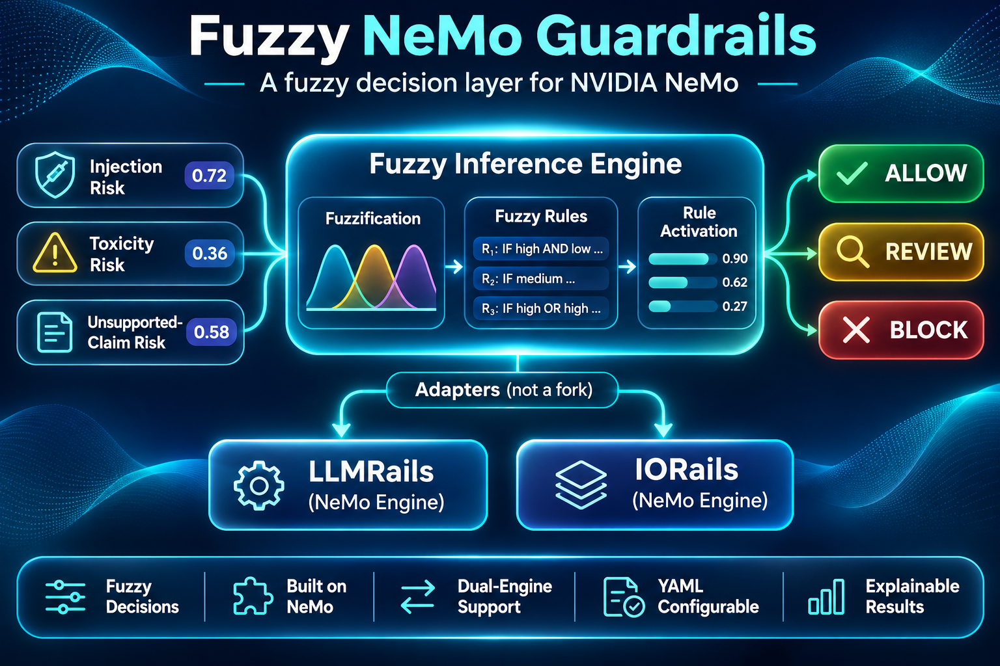
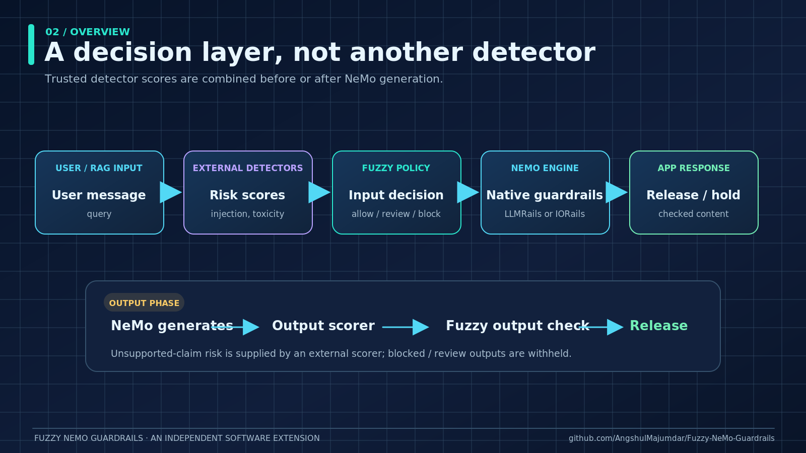
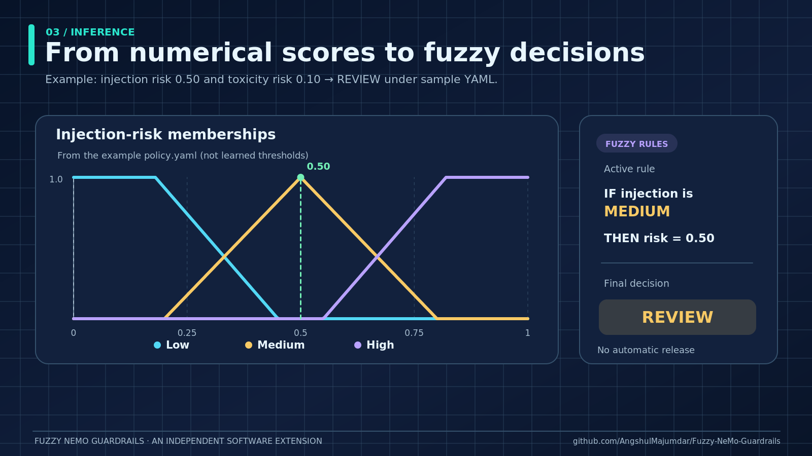
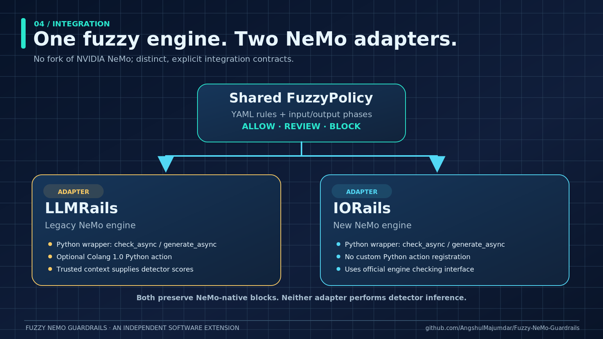
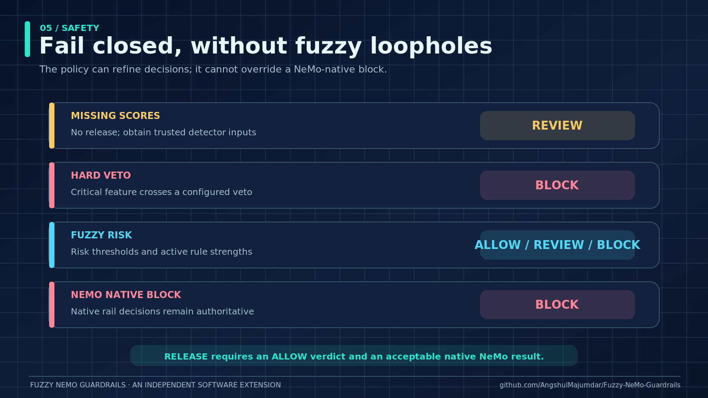
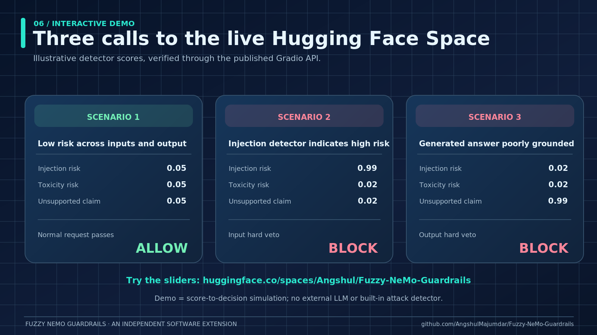

# Fuzzy NeMo Guardrails: Adding Degrees of Judgment to NVIDIA's Guardrails

**A practical, CPU-friendly fuzzy decision layer for both LLMRails and IORails.**

**Source code:** [GitHub — Fuzzy NeMo Guardrails](https://github.com/AngshulMajumdar/Fuzzy-NeMo-Guardrails)  
**Interactive demo:** [Hugging Face — Fuzzy NeMo Guardrails](https://huggingface.co/spaces/Angshul/Fuzzy-NeMo-Guardrails)



*Concept illustration of the project. The numbers are illustrative, not real detector measurements.*

## Guardrails need more than a binary threshold

A conventional guardrail often ends with a yes or no: let the request proceed, or stop it. But in a real retrieval-augmented generation (RAG) application, signals rarely line up so neatly. A query may have some suspicious structure without being clearly malicious. A retrieved passage may partially support a generated answer. The detector may be uncertain, while the application's rules are not.

**Fuzzy NeMo Guardrails** is a small, independent software extension that handles these intermediate cases. It does not replace NVIDIA NeMo Guardrails, and it does not introduce another language model. It accepts **normalized scores produced by trusted detectors**, applies configurable fuzzy rules, and returns one of three decisions: **ALLOW, REVIEW, or BLOCK**.

The critical distinction is that REVIEW is a hold, **not** permission to continue. Native NeMo guardrails remain in force. The fuzzy layer can never turn a NeMo BLOCK into an ALLOW.

## Where the layer sits



*The extension consumes external input and output detector scores; the configured NeMo engine still enforces its own native rails.*

Think of the implementation as a policy decision layer around an existing NeMo application. A trusted detector supplies an injection-risk or toxicity-risk score for an incoming request. The fuzzy policy translates those numbers into membership strengths, activates applicable rules, and decides whether to allow the next step, hold for review, or block it.

Where output protection is configured, an external scorer can assess the generated response—for example, its unsupported-claim risk—and the wrapper withholds the response unless the output policy allows it. **The demo uses manually supplied scores**, not automatic prompt-injection or hallucination detection. Production deployments need real, validated detector integrations.

## What fuzzy actually means here



*Exact example from the published YAML policy: injection risk 0.50, toxicity risk 0.10, and the medium-risk rule fires; the resulting input decision is REVIEW.*

Fuzziness here is a way to express gradual rule applicability. A detector score can belong partly to *low*, *medium*, and *high* linguistic categories. Each rule receives a firing strength, so the policy need not pretend that an arbitrary boundary makes two nearly identical requests fundamentally different.

The sample input policy uses **Sugeno** inference; the sample output policy uses **Mamdani** inference. Both are configured in YAML, including membership shapes, rule conditions, thresholds and hard-veto limits. The engine reports the active rules and their strengths, so an application can explain *why* it reached a decision. These fuzzy membership values are **not calibrated probabilities**.

The example policy is deliberately illustrative, not a ready-made security standard. In production, application owners are responsible for detector quality, threshold selection and checking the consequences of false blocks and false allows.

## Both NeMo engines: one shared fuzzy policy



*The shared FuzzyPolicy is separate from the two NeMo integrations, avoiding an unnecessary fork of NVIDIA's project.*

This package supports **LLMRails**, the legacy NeMo execution engine, through a Python wrapper and an optional custom action that can run inside a Colang 1.0 flow. It also supports **IORails**, the newer execution engine, through an external Python wrapper using public checking and generation APIs.

The distinction matters: IORails in NeMo 0.25.0 does not execute the legacy Python custom-action mechanism, so this project **does not claim a native Colang-style IORails action**. It supplies a compatible wrapper instead. Neither adapter runs its own LLM or manufactures detector scores.

## Safety rules remain absolute



*A fuzzy score can refine a policy decision, but hard vetoes and native NeMo blocks still take precedence.*

A useful rule engine must be predictable at its boundaries. In Fuzzy NeMo, missing mandatory scores result in REVIEW and withheld output; configured hard vetoes trigger BLOCK. Unexpected native statuses are withheld for REVIEW. An output that receives REVIEW or BLOCK is not returned to the caller, and the wrapper deliberately does not support streaming unchecked tokens.

This also means a low fuzzy risk score cannot bypass a NeMo-native block. In effect, the extension adds expressive policy decisions **without relaxing absolute safety requirements**.

## Try it: three decisions from the live demo



*Three example API calls to the published Space on November 26, 2026. All values are manually supplied test inputs.*

In the [live Hugging Face Space](https://huggingface.co/spaces/Angshul/Fuzzy-NeMo-Guardrails), you can move three sliders: injection risk, toxicity risk and unsupported-claim risk. The interface displays the decision, the computed fuzzy risk and the activated rules. A low-risk example returns ALLOW; a high injection-risk example returns BLOCK; and a high unsupported-claim-risk example also returns BLOCK.

This is intentionally a **CPU-only, no-LLM demonstration of the fuzzy policy**, not a fully connected production RAG security gateway. It makes the decision logic easy to examine and reproduce.

## How to run it yourself

Clone the [GitHub repository](https://github.com/AngshulMajumdar/Fuzzy-NeMo-Guardrails) and install the package:

```bash
git clone https://github.com/AngshulMajumdar/Fuzzy-NeMo-Guardrails.git
cd Fuzzy-NeMo-Guardrails
pip install -e '.[api,test]'
pytest -q
```

Evaluate an input policy directly:

```bash
fuzzy-nemo --config examples/policy.yaml --phase input --scores '{"injection_risk": 0.05, "toxicity_risk": 0.10}'
```

To run the actual NeMo 0.25.0 integration examples locally:

```bash
pip install -e '.[nemo]'
python examples/legacy_colang/run_local.py
python examples/iorails/run_local.py
```

The repository also includes a FastAPI service, Docker configuration, automated tests and reproducible integration examples. GitHub Actions checks both supported Python versions and runs a dedicated NeMo 0.25.0 integration suite.

## What this package is—and is not

Fuzzy NeMo Guardrails is **an implementation project**: configurable fuzzy policies, explainable decisions, conservative integration with two NeMo engines, and a demonstrable CPU-only interface. It is independent of NVIDIA and is **not** an official NVIDIA product or a replacement for native NeMo safety controls.

The implementation does **not** independently detect prompt injection, toxicity, hallucination or grounding failures. Those scores must come from external, trusted detectors; the application must withhold or handle REVIEW results appropriately. Model-backed generation and real-world RAG deployments still require application-level testing.

**Explore the code:** [github.com/AngshulMajumdar/Fuzzy-NeMo-Guardrails](https://github.com/AngshulMajumdar/Fuzzy-NeMo-Guardrails)  
**Run the live demo:** [huggingface.co/spaces/Angshul/Fuzzy-NeMo-Guardrails](https://huggingface.co/spaces/Angshul/Fuzzy-NeMo-Guardrails)

*NeMo Guardrails is a project of NVIDIA. This extension is independent and Apache-2.0 licensed. Figures are original illustrations created for this project.*
